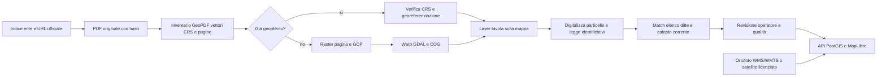

# Piano tecnico: piani particellari sulla mappa GeoIntelligence

## Obiettivo concreto

Per ogni opera, aprire una mappa con immagine di fondo, tracciato dell'opera, particelle catastali correnti e tavole del piano particellare storico sovrapposte alla posizione corretta. Selezionando una particella o una ditta, la mappa deve mostrare il documento originale, la pagina, l'identificativo catastale, la fonte della geometria e la qualità del posizionamento.

La mappa deve distinguere chiaramente:

1. **Immagine di riferimento**: ortofoto o immagine satellitare, utile per orientamento e confronto visivo.
2. **Catasto corrente**: geometrie ufficiali WFS dell'Agenzia delle Entrate, con identificativi e data di acquisizione.
3. **Piano particellare del progetto**: tavola storica georiferita; non va fatta coincidere automaticamente col catasto odierno.
4. **Particelle/ditta di progetto**: geometrie digitalizzate dalla tavola e collegate all'elenco ditte soltanto dopo aver riscontrato gli identificativi.

Questi quattro livelli hanno fonti, date e precisioni diverse e devono poter essere accesi, spenti e confrontati separatamente.

## Stato attuale del repository e dati

- La mappa usa MapLibre GL JS e visualizza geometrie GeoJSON reali; il selettore cartografia stradale/satellite è stato aggiunto. I layer catastali restano distinti dallo sfondo.
- Il collector archivia PDF con URL e SHA256; l'estrattore conserva pagine e righe OCR. Il localizzatore WFS trasforma le geometrie in EPSG:4326 e salva le risposte GML originali.
- Il piano particellare Pavia già archiviato (documento MASE 1204230) è un PDF AutoCAD A0, una pagina, scala 1:1000. `pdfinfo` non rileva metadati personalizzati; `pdfplumber` trova 30.976 tracciati vettoriali, 6.915 linee e 2 immagini incorporate. Quindi non è una semplice scansione: prima di rasterizzare va verificato il CRS/GeoPDF e valutata l'estrazione del disegno CAD vettoriale.
- Per Rho–Gallarate cinque righe d'atto corrispondono a tre particelle correnti acquisite. I numeri sono stati confrontati con le pagine originali; i nominativi OCR sono ancora da verificare.
- L'indice pubblico MASE della Rho–Gallarate contiene 1.658 documenti e numerosi piani particellari per comune e tavola. È emerso un elenco delle ditte di Rho già archiviato come documento 95255. Le altre tavole dell'indice non sono state ancora scaricate.
- L'archivio usa SQLite e file sul disco locale. Il filesystem effimero di una Function Vercel non è un archivio persistente; la pubblicazione dei PDF e dei raster non è ancora configurata.

### Revisione della vista mappa

La pagina `quadro_interferenze.html` è la base reale da estendere: recupera opere e particelle dalle API dell'archivio e disegna solo le geometrie catastali effettivamente acquisite. Non sostituirla con una pagina che assume `dist_gis/piano_completo_interferenze_wgs84.geojson`, percentuali di occupazione o ditte già geocodificate: questi dati non sono disponibili in modo generale nell'archivio e non vanno simulati.

È stato aggiunto un selettore tra cartografia stradale e immagine satellitare Esri, con overlay dei riferimenti geografici e attribuzione dei layer. L'immagine è solo uno sfondo di orientamento: copertura, data, risoluzione e allineamento variano nello spazio; non è una fonte per certificare confini catastali o georeferenziare tavole. Esri espone le fonti dell'immagine e indica risoluzioni diverse secondo copertura e luogo ([World Imagery](https://www.arcgis.com/home/item.html?id=10df2279f9684e4a9f6a7f08febac2a9)).

Il vecchio endpoint CARTO senza chiave è stato tolto dalla vista: i termini CARTO aggiornati richiedono chiavi API proprie anche per i servizi gratuiti, limiti d'uso e attribuzione ([termini CARTO Basemaps](https://carto.com/legal/basemap-terms/)). Un futuro ritorno a CARTO va configurato con chiave dell'account e condizioni appropriate al caso d'uso commerciale.

Il prototipo HTML incollato resta una specifica di interazione, non una pipeline dati pronta: la ricerca solo foglio/mappale può essere ambigua tra comuni/sezioni; le aree e le percentuali richiedono un piano vettoriale ufficiale, CRS noto e classi esproprio/asservimento/occupazione temporanea separate; i popup devono continuare a escapare i dati e puntare all'atto originale. Per overlay e ricerche di produzione usare identificativi stabili, chiavi catastali complete e API autorizzate, mai un export statico pubblico di righe con dati personali.

La revisione dello screenshot ha individuato un rischio concreto nel vecchio layer principale: `tracciato_suite.js` conteneva assi precompilati a mano e ne inventava altri curvando il punto dell'opera; inoltre il pulsante “particelle” portava al punto `op.geo`, non ai poligoni. Questi assi sono stati rimossi, il pulsante ora inquadra i poligoni catastali effettivi (o resta disabilitato se mancano) e il pin è esplicitamente descritto come posizione dell'opera, non del mappale. Lo screenshot “Mappa Piacentino A1–A21” non corrisponde a stringhe o dati del repository locale, quindi la specifica particella Suzzara non è ancora verificabile da questa copia: per validarla occorre acquisire la geometria ufficiale di `L020 / foglio 48 / particella 55` e confrontarla con la coordinata riportata nello screenshot, senza inferire la geometria dal pin.

La regola di rendering è stata irrigidita: un overlay d'opera richiede `tracciato_geojson` con asse lineare, `fonte_tracciato_url` e `tracciato_verificato: true` (oppure `stato_tracciato: "verificato"`). Senza tutti e tre gli elementi non si disegnano assi, fasce o particelle collegate all'opera e il comando mappa non fa zoom sul pin generico. L'importazione di un tracciato utente resta un'azione esplicita separata.

Sono stati acquisiti i KMZ utente `APL_progetto Tratta B2.kmz` e `APL_progetto Tratta C.kmz`, conservati senza modifica con SHA256 in `data/production/apl/source/`. L'importazione in EPSG:4326, senza semplificazione, ha prodotto il GeoPackage privato `data/production/apl/apl_tratte_B2_C_candidate.gpkg` e i GeoJSON di revisione. B2 contiene 1.862 poligoni nel layer `progetto`, 3.225 linee e 1.196 punti nel layer `npp3`; C contiene 3.077 poligoni in `Progetto`, 3.836 linee e 1.443 punti in `Piani`. I dati ricoprono corridoi compatibili con le tratte B2 e C descritte da [APL B2](https://pedemontana.com/it/le-nuove-tratte/tratta-b2) e [APL C](https://pedemontana.com/it/le-nuove-tratte/progetto-definitivo/tratta-c), ma non includono un asse lineare unico riconoscibile né metadati che certifichino autore, versione o significato catastale di ogni elemento. Per questo sono marcati candidati e non sono collegati a ditte, indennità o superfici di esproprio.

È disponibile sulla mappa principale un comando esplicito **APL B2/C · KMZ utente** che carica i due layer in modalità revisione e inquadra l'estensione. Resta spento all'apertura; popup e legenda mantengono fonte e stato non verificato. L'endpoint legge esclusivamente i due GeoJSON privati fissi dall'archivio e non accetta percorsi forniti dal client.

## Tecnologie consigliate

### PDF, tavole e georeferenziazione

1. **Inventario automatico**: per ogni PDF controllare prima se è un GeoPDF, se contiene livelli vettoriali, riferimenti spaziali, griglia/coordinatometro, scala, data e sistema di riferimento. GDAL può leggere e rasterizzare GeoPDF georiferiti e pubblicare le pagine multipagina come subdataset; per alcuni PDF l'accesso raster rasterizza l'intera pagina, quindi va fatto in job asincrono e con cache.
2. **PDF CAD vettoriale non georiferito**: estrarre paths/curve e blocchi di testo prima di rasterizzare. Il PDF Pavia è il caso concreto per questo ramo. PyMuPDF `Page.get_drawings()` e/o l'estrattore PDF esistente possono fornire i segmenti in coordinate pagina. Ricomporre linee in poligoni, conservando colore/stile, bounding box e pagina; usare testo e legenda della tavola per classificare particelle e aree di occupazione. La trasformazione pagina→CRS va comunque stimata e validata: la presenza di vettori non fornisce da sola coordinate geografiche.
3. **PDF non georiferito solo raster/scansione**: renderizzare la pagina scelta a 300–400 dpi in un raster di lavoro, ritagliare la cornice cartografica senza alterare l'originale e raccogliere punti di controllo. Usare prima coordinate/griglia stampate sulla tavola; se mancano, usare elementi stabili e identificabili sull'ortofoto (incroci, ponti, manufatti), non il centro del comune.
4. **Trasformazione**: partire da affine/polinomiale di primo ordine per tavole piane e scansioni regolari. QGIS/GDAL devono salvare GCP, algoritmo, CRS, residui per punto e RMS. Secondo ordine o thin plate spline solo quando la deformazione della scansione lo richiede e con controlli indipendenti: possono adattare bene la carta ma spostare localmente i confini.
5. **Revisione umana**: una vista di lavoro affiancata all'originale permette a un tecnico di correggere GCP e digitalizzare particelle. L'AI può suggerire numeri, poligoni e candidati, ma una corrispondenza ambigua o un confine estratto automaticamente resta non verificato.

QGIS Georeferencer è la via più rapida per il primo pilot e produce un report con trasformazione, residui e RMS. GDAL è la via ripetibile per l'elaborazione, esportazione e controllo automatico. Per le pagine georiferite, controllare prima il driver PDF GDAL; non georeferenziare di nuovo una tavola che ha già coordinate corrette.

### Immagini di fondo

- **Prima scelta per il pilot lombardo**: ortofoto AGEA/Regione Lombardia via WMTS/WMS pubblicato dal Geoportale. La Regione indica la disponibilità dell'ortofoto 2024 e l'uso dei servizi OGC come base cartografica GIS. È ortofoto aerea, non necessariamente un'immagine satellitare; normalmente è più utile del satellite gratuito per confrontare particelle e manufatti.
- **Immagine satellitare commerciale**: aggiungere un provider (ad esempio Esri o Google Maps Tiles API) solo dopo avere scelto piano, credenziali, attribuzione e condizioni d'uso. L'API Google vieta caching/prefetch e usi di analisi o estrazione; pertanto non va usata come fonte di GCP, input di GeoAI o archivio di immagini. Per una UI dimostrativa/visuale può essere idonea solo rispettandone i termini.
- **Copernicus Sentinel-2**: utile per cambiamento territoriale, uso del suolo e contesto ambientale; le bande più dettagliate sono a 10 m, troppo grossolane per verificare confini di mappali. Non usarla come base per affermare precisione catastale.
- **MapLibre**: aggiungere il fondo come `raster` WMS/WMTS/XYZ con attribuzione sempre visibile; mantenere il progetto GeoJSON e le tavole come overlay separati. Il `RasterTileSource` MapLibre documenta anche WMS tramite template BBOX. Evitare download massivo e riutilizzo di tile se la licenza del fornitore non lo consente.

La licenza va conservata per ogni layer, non dedotta dal fatto che il servizio sia tecnicamente accessibile. Alcune ortofoto sono pubbliche solo in consultazione o con condizioni specifiche.

### Dove entrano geodesia, rilievo, GeoAI, LiDAR, BIM e pianificazione

- **Geodesia e surveying** sono il nucleo del pilot: identificare il CRS/datum della tavola, trasformarlo in modo documentato, controllare punti indipendenti e misurare errore in metri.
- **GeoIntelligence** è l'integrazione di fonti, date e scale: documento approvato, catasto storico, WFS corrente, ortofoto e stato dell'opera devono essere comparabili nello stesso spazio, senza nascondere differenze temporali.
- **GeoAI/ML** accelera l'OCR e propone segmentazioni di tavole. I suggerimenti devono conservare evidenza pixel/pagina, confidenza e revisione; l'AI non decide proprietà né corregge da sola un confine legale.
- **LiDAR** è utile quando il problema riguarda quote, scarpate, drenaggi, volumi, ostacoli o interferenze tridimensionali. Non è il metodo per ricavare confini catastali; i dati LiDAR si aggiungono dopo il pilot e solo con copertura, data e accuratezza note.
- **BIM/digital twin** è la fase successiva per associare particelle e ditte a tratta, progressive/chilometriche, fasi di cantiere e oggetti IFC. Il legame deve essere spaziale e temporale (versione del progetto), non solo un tag testuale.
- **Urban planning** entra come layer di contesto separato: strumenti urbanistici, vincoli, uso del suolo e infrastrutture da servizi pubblici. Va mostrata la fonte e la data di ciascuna disciplina, senza confonderla con l'atto espropriativo.
- **PMP/governance**: ogni fase ha un deliverable misurabile e un gate qualità. Non si amplia in massa la copertura finché il pilot non dimostra che pagina, geometria, CRS e identificativo catastale restano tracciabili dall'interfaccia fino all'originale.

### Formati e infrastruttura di produzione

- **Originali**: PDF immutabili content-addressed, già previsti dall'archivio.
- **GCP e revisione**: JSON versionato collegato a `documento_id`, pagina, versione e SHA256 del PDF.
- **Tavole elaborate**: Cloud Optimized GeoTIFF (COG) con CRS e overviews; raster tiles erogati da TiTiler o servizio equivalente. Per un prototipo a una sola pagina MapLibre `image` source con quattro coordinate può bastare, ma non scala a molte tavole/zoom.
- **Geometrie vettoriali**: GeoJSON per il pilot; PostGIS per ricerca spaziale, versioni e relazioni in produzione.
- **Persistenza**: database PostgreSQL/PostGIS gestito e object storage privato per PDF, COG e GCP. Le API Vercel possono servire metadati e autorizzare l'accesso agli oggetti; non conservare gli archivi nel filesystem effimero delle Function.

SQLite locale resta utile per sviluppo e importazione; prima del deploy con dati reali va definita la persistenza condivisa e il backup.

## Modello dati da aggiungere

Una tavola deve contenere almeno:

```text
tavola_id, opera_slug, documento_id, pagina_pdf, titolo, comune, data_tavola,
scala_dichiarata, crs_sorgente, stato_georeferenziazione,
trasformazione, gcp[], rmse, errore_massimo, operatore, revisionata_il,
asset_raster_url, sha256_raster, metodo_georeferenziazione
```

Ogni poligono digitalizzato deve contenere:

```text
feature_id, tavola_id, geometry, comune, sezione, foglio, mappale, sub,
identificativo_letto, collegamento_riga_ditta, metodo_estrazione,
confidence, stato_revisione, pagina_pdf, nota_discrepanza
```

Il legame alla ditta deve avere un esito esplicito: `esatto_documento`, `candidato_ai`, `verificato_operatore`, `ambiguo`, `non_corrispondente`. Il match automatico esatto usa comune catastale, sezione, foglio, particella e sub; non correggere fuzzy un identificativo catastale senza revisione.

## Valutazione dello script di join proposto

Lo script GeoPandas condiviso è una buona **prova di concetto per un passaggio limitato**: date righe catastali già estratte e un vettoriale catastale con attributi affidabili, può associare i record alle geometrie e generare output per il WebGIS. Non georiferisce il PDF: il GeoPackage/shape catastale deve essere già collocato correttamente. Quindi serve per il collegamento ditta→particella, non per portare la tavola storica sulla mappa.

Prima di usarlo su dati di produzione vanno corretti questi rischi:

1. **CRS mancante**: impostare `EPSG:3003` con `set_crs()` non trasforma i dati e non dimostra che quel CRS sia corretto. È un'assegnazione silenziosa, pericolosa. Se manca il CRS, mettere il file in quarantena e recuperare CRS/datum dalla fonte o da chi ha prodotto il file; poi usare `to_crs()` per trasformare.
2. **EPSG:3857 non è CRS per misure catastali**: va bene per visualizzazione/tile, ma distorce lunghezze e aree. Per calcoli usare il CRS proiettato metricamente appropriato all'area e dichiarato dalla fonte; per mappa Web esportare una copia in EPSG:4326.
3. **Chiave catastale**: usare il codice catastale stabile, non mischiare nome comune con codice Belfiore nello stesso campo. Normalizzare sezione, foglio, mappale e subalterno come componenti separati; preservare il valore originale. Non togliere zeri e suffissi alla cieca, non trasformare valori mancanti in stringa `nan`/`<NA>`, e non unire subalterni diversi come se fossero una sola riga di proprietà.
4. **Fallback dei campi**: `row.get("comune", row.get("cod_belfiore"))` non usa `cod_belfiore` se la colonna `comune` esiste ma è vuota. I fallback devono scegliere il primo valore non nullo dopo aver validato lo schema.
5. **Join**: `len(gdf_unito)` è numero di righe risultato, non numero di mappali abbinati. Un duplicate key sul layer catastale può creare un join molti-a-molti non visibile. Verificare l'unicità geometria per chiave, usare `merge(validate="one_to_many")` dal catasto univoco alle righe ditta, e scrivere un file delle righe unmatched/duplicate.
6. **Validità geometrie**: `make_valid()` può restituire `GeometryCollection` o più parti. Estrarre le sole geometrie poligonali, segnalare le riparazioni e conservare il dato iniziale/checksum; non scartare gli errori senza report.
7. **Attualità**: un WFS catastale corrente non è automaticamente il catasto vigente alla data del piano. Ogni match va marcato come corrente e collegato al documento/data del progetto; frazionamenti e numerazioni cambiate richiedono una relazione storica o revisione, non una correzione automatica.
8. **Provenienza e privacy**: gli output devono portare identificativo del documento/pagina, URL, checksum, data, CRS e licenza della geometria. CSV/GeoJSON con nominativi e dati personali restano in storage privato e non devono diventare file statici pubblici.

La forma sicura della chiave è una tupla/campi distinti, ad esempio `(codice_comune_catastale, sezione, foglio_norm, mappale_norm)`. Separare questa chiave da quella proprietaria/subalterno evita di duplicare una geometria di particella in modo ambiguo. L'API può restituire una feature per particella unica con più righe collegate, come già fa il quadro mappa.

## Valutazione dello script di overlay fascia–particelle

Il secondo script propone un'analisi corretta come obiettivo geometrico, ma la sua attuale classificazione non va usata per provvedimenti, frazionamenti o stime. Nel repository esiste già `elabora_interferenze_spaziali()`: trasforma le geometrie in un CRS metrico valido, usa l'indice spaziale per preselezionare i mappali e unisce le fasce calcolate dal tracciato. Quella funzione è utile quando si dispone solo dell'asse dell'opera; una fascia ufficiale importata dalla tavola del piano deve diventare una **fonte geometrica distinta e preferenziale**, con i buffer euristici mantenuti esplicitamente come stime.

Correzioni necessarie nello script condiviso:

- **CRS**: fallire se il CRS manca o non è documentato; non assegnare automaticamente EPSG:3003. EPSG:25832 è appropriato per molte opere in Lombardia, ma il motore ha opere in tutta Italia: usare il CRS metrico locale derivato dalla fonte/area dell'opera (come fa il motore esistente) e mantenere il CRS sorgente. EPSG:3857 va usato solo per tile/display, mai per aree.
- **Particelle e ditte**: rendere unica la geometria catastale per chiave catastale prima di intersecare. Se più ditte, diritti o subalterni si riferiscono allo stesso mappale, l'intersezione si calcola una volta per la particella e i risultati si collegano poi a tutte le righe ditta. Il merge deve controllare duplicati e cardinalità; `len(gdf_intersezione)` non equivale a mappali unici.
- **Classi di occupazione**: `dissolve()` su tutte le fasce perde il tipo (esproprio, asservimento, occupazione temporanea) e fonde aree con effetti diversi. Conservare `tipo_area`, fonte, data e stato di approvazione; dissolvere separatamente per categoria. Calcolare l'area geometrica totale interessata sull'unione spaziale per non contare due volte zone sovrapposte, ma conservare anche le aree per categoria con regole dichiarate.
- **Residuo**: sottrarre dal mappale solo la geometria di acquisizione permanente per ottenere il residuo di proprietà. Asservimento e occupazione temporanea non cancellano la proprietà del terreno; le loro superfici e limitazioni vanno riportate a parte.
- **Area e arrotondamenti**: `geometry.area` del WFS è area planimetrica ricavata dalla geometria catastale corrente, non necessariamente superficie catastale/di progetto certificata. Chiamarla `area_geom_catasto_corrente_mq`, conservare la precisione piena durante calcoli e arrotondare solo nell'interfaccia/report; confrontare con l'area dichiarata nell'atto senza sostituirla.
- **Validità e casi nulli**: dopo `make_valid`, conservare solo parti poligonali, registrare riparazioni e scarti; gestire geometrie nulle/vuote, area zero e overlay senza intersezioni prima di dividere o leggere colonne del risultato.
- **Classificazione legale**: la soglia del 98% può al massimo produrre un indicatore `quasi_interamente_interferita_da_verificare`. Non determina esproprio totale, frazionabilità o indennità. Un residuo piccolo può avere o non avere autonomia; servono accesso, forma, uso, atti e valutazione tecnica/amministrativa.
- **Fascia fonte**: distinguere tracciato di massima, buffer stimato, occupazione di cantiere, fascia di asservimento e sagoma approvata per acquisizione. Solo la geometria di progetto approvata e documentata può essere etichettata come perimetro pubblicato; un buffer calcolato non deve apparire come area espropriata ufficiale.

Pipeline di overlay corretta: identificare e versionare le particelle uniche → importare le geometrie del piano con `tipo_area` e fonte → verificare CRS/topologia → riproiettare in CRS locale metrico → intersecare per classe e calcolare unione totale senza doppio conteggio → calcolare il residuo rispetto alla sola acquisizione permanente → collegare l'output alle righe ditta e al PDF/pagina → esportare GeoJSON per la mappa e GeoPackage/PostGIS per analisi. MapLibre dovrebbe mostrare per ogni layer se è **ufficiale**, **estratto dalla tavola**, **revisionato**, oppure **stimato dal tracciato**.

## Pipeline proposta



La tavola georiferita si può mostrare anche prima della vettorializzazione. In tal modo il primo risultato utile è il PDF dell'ente sovrapposto all'ortofoto; i poligoni e il collegamento ditta/particella arrivano poi come fase distinta.

## Piano di esecuzione

### Fase 1 — Pilot tecnico Pavia e pilot d'integrazione Rho–Gallarate

1. **Pilot tecnico su Pavia**: usare il PDF già archiviato (`1204230`, SHA256 `5fbb…76fb`). Installare/attivare GDAL con driver PDF e PyMuPDF; controllare eventuali riferimenti geospaziali e confrontare `get_drawings()` con le curve già rilevate da pdfplumber. La macchina di sviluppo attuale non ha `gdalinfo`/`ogrinfo`, quindi questo controllo è ancora da fare.
2. Se Pavia non contiene georeferenziazione, verificare la sezione/foglio riportati nel cartiglio, estrarre gli identificativi visibili e provare il match alle particelle correnti WFS solo come candidata. Stimare la trasformazione dai contorni corrispondenti, tenere particelle diverse fuori dal fit come controllo indipendente e registrare le discrepanze storiche.
3. **Pilot d'integrazione Rho**: acquisire una tavola dall'indice MASE con URL/titolo/sha; ad esempio le tavole di Rho hanno codici `MDL110D43BDAQ...` e l'elenco ditte `MDL110D43EDAQ0100001A` corrisponde al documento 95255 già archiviato. Questo pilot verifica il collegamento tavola→pagina→identificativi→righe proprietari, non solo la sovrapposizione raster.
4. Per ogni tavola georiferita, mostrare in MapLibre ortofoto di sfondo, vettori o raster del piano con opacità regolabile, particelle catastali WFS e link alla pagina PDF. Stato e statistiche di accuratezza devono essere visibili.
5. Digitalizzare un piccolo gruppo di poligoni e confrontare identificativi col registro ditte; misurare l'errore su checkpoint indipendenti e descrivere le differenze col catasto corrente.

**Uscita fase 1**: il test documenta se la tavola Pavia è geospaziale/CAD, produce overlay vettoriale o raster con trasformazione riproducibile, e un sottoinsieme viene collegato a righe ditta solo dove il riscontro regge. Il pilot Rho aggiunge la verifica con l'elenco ditte. Se una tavola non ha coordinate, griglia o elementi stabili sufficienti, si dichiara il limite oppure si ferma la georeferenziazione: non si inventano coordinate.

### Fase 2 — Pipeline ripetibile

- Aggiungere `plan_sheet_ingest.py`: inventario, pagine, rilevamento GeoPDF, metadati e rasterizzazione controllata.
- Aggiungere tabelle SQL per tavole, GCP, asset raster, features estratte e revisione. Ogni rilavorazione crea versione nuova senza sovrascrivere l'originale.
- Aggiungere worker asincrono per conversione GDAL, generazione COG/overviews e statistiche di qualità; il processo non gira in una richiesta HTTP sincrona.
- Supportare i raster WMS/WMTS dei geoportali tramite configurazione per regione e licenza del singolo layer.
- Implementare UI: selettore base map, elenco tavole/pagine, toggle layer, opacità, legenda, click/hover, fonti e date, stato di qualità e link al PDF.

### Fase 3 — Estrazione e collegamento GeoAI

- OCR/vision legge comuni, fogli, mappali, subalterni, legende e testi; l'estrazione restituisce testo, bounding box sul PDF e confidenza.
- Computer vision suggerisce geometrie di particella solo dentro il perimetro cartografico georeferenziato, conservando il riferimento in pixel e le coordinate geografiche risultanti.
- Match deterministico con l'elenco ditta; i casi dove il piano storico e il WFS corrente differiscono per frazionamento sono messi in coda di revisione, non forzati.
- I modelli possono proporre, mai confermare proprietà, intestatari o confini catastali.

### Fase 4 — Estensione a tutte le opere e pubblicazione

- Elaborare gli indici degli enti e classificare le fonti: avviso, elenco ditte, piano grafico, tracciato, variante, elaborato superato.
- Importare ogni documento nella corretta opera/lotto/CUP e tracciare versioni sostituite.
- Migrare dati reali da SQLite locale a PostgreSQL/PostGIS e file ad object storage privato; configurare autenticazione, backup e retention.
- Aggiungere layer e processi specifici per Provincia autonoma, coordinate locali e catasti storici dove il WFS nazionale non basta.

## Controlli di qualità e limiti

- Registrare CRS originale e trasformazione; mai assumere che ogni tavola sia in WGS84/UTM o che usi lo stesso datum del WFS.
- Registrare GCP, residui per punto, RMS e controllo indipendente. Un basso RMS dei GCP usati nel fit non sostituisce un checkpoint indipendente.
- Mostrare un buffer/alone di incertezza quando la scala, la deformazione o i punti di controllo non supportano una sovrapposizione precisa.
- Il confine digitalizzato dalla tavola di progetto, il confine catastale corrente e l'immagine di fondo possono non coincidere per data, precisione e modifiche successive.
- Ortofoto/satellite sono fondi di visualizzazione. Non usare immagini di base non licenziate come input di analisi, training, vettorializzazione o prova catastale.
- L'esito del pilot deve essere validato da un tecnico topografo/catastale prima di estenderlo come dato produttivo.

## Fonti tecniche primarie

- [GDAL PDF driver — Geospatial PDF, rasterizzazione, CRS e pagine](https://gdal.org/en/stable/drivers/raster/pdf.html)
- [GDAL Raster Data Model — geotransform e Ground Control Points](https://gdal.org/en/stable/user/raster_data_model.html)
- [QGIS Georeferencer — algoritmi, residui e report RMS](https://docs.qgis.org/4.2/en/docs/user_manual/managing_data_source/georeferencer.html)
- [MapLibre RasterTileSource — tile raster e WMS](https://maplibre.org/maplibre-gl-js/docs/API/classes/RasterTileSource/)
- [Geoportale Lombardia — ortofoto 2024, WMS/WMTS e catalogo](https://www.geoportale.regione.lombardia.it/)
- [Regione Lombardia — servizi e condizioni di consultazione dei prodotti cartografici](https://www.geoportale.regione.lombardia.it/consultazione-e-distribuzione)
- [Dati.gov.it — Cartografia catastale Italia e WFS Agenzia delle Entrate](https://www.dati.gov.it/node/view-dataset/dataset?id=9d74351a-eb63-4f64-848a-69770e9722b2)
- [Regolamento INSPIRE — accuratezza posizionale espressa come estimatedAccuracy](https://eur-lex.europa.eu/legal-content/EN/TXT/PDF/?uri=CELEX:02010R1089-20231119)
- [Copernicus Data Space — risoluzione Sentinel-2](https://dataspace.copernicus.eu/data-collections/copernicus-sentinel-missions/sentinel-2)
- [Google Maps Tile API policies — attribuzione e divieto di cache/analisi](https://developers.google.com/maps/documentation/tile/policies)
- [Esri Basemap Styles API — satellite e servizi imagery](https://developers.arcgis.com/rest/basemap-styles/)

## Decisione tecnica raccomandata

Partire con **Rho–Gallarate + una tavola + ortofoto regionale via WMS/WMTS + GDAL/QGIS + overlay raster in MapLibre**. Prima validare la qualità di georeferenziazione e il collegamento ai mappali; poi decidere se conviene vettorializzare automaticamente e quale provider satellitare licenziare. Non partire da modelli GeoAI o dal satellite a 10 m: non risolvono il problema principale, che è posizionare e versionare correttamente la tavola del progetto.
